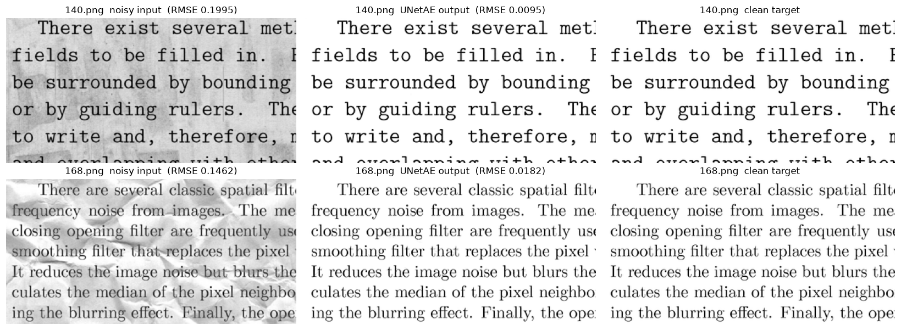

# 문서 이미지 노이즈 제거: 층을 늘리는 것보다 정보가 흐르는 길이 중요했다

> **한 줄 요약:** 얼룩과 구김으로 손상된 문서 이미지를 CNN 오토인코더로 복원했습니다. 검증 RMSE를 기준선 0.1551에서 **0.0128**(약 92% 감소)까지 낮췄고, Kaggle 점수는 **0.01837**입니다. 깊이와 채널을 늘린 모델은 "모두 흰색" 상태에 갇혔습니다. 결과를 바꾼 것은 **스킵 커넥션 구조**와 **모델 크기에 맞춘 학습률**이었습니다.

| 항목 | 내용 |
| --- | --- |
| 데이터 | 손상 문서 train 144장(원본 짝 있음) / test 72장, 크기 420×540과 258×540 두 종류 |
| 도구 | Python, PyTorch (Conv2d, ConvTranspose2d), NumPy, PIL, ONNX Runtime Web, Gradio |
| 노트북 | [`document_denoising.ipynb`](./document_denoising.ipynb) |
| 데모 | [Hugging Face Space에서 바로 써 보기](https://huggingface.co/spaces/donyeon/document_denoising) (브라우저 안에서 작동, 설치 없음) |



*검증 이미지 두 장의 왼쪽 위 부분입니다. 위는 가장 크게 개선된 140.png, 아래는 복원 오차가 가장 컸던 168.png입니다.*

---

## 1. 문제: 무엇을 왜 풀려고 했나

- **입력:** 얼룩·구김·접힘이 있는 흑백 문서 이미지
- **출력:** 같은 크기의 깨끗한 이미지(픽셀값 0~1). 모든 픽셀 값을 맞히는 회귀 문제입니다.
- **평가:** RMSE(대회 지표)와 PSNR = 20 × log10(1 / RMSE)
- **기준선:** 손상본을 그대로 제출하면 검증 RMSE **0.1551**(16.19 dB)입니다. 전부 흰색으로 칠하면 0.2855로 더 나쁩니다. 모델은 손상본보다 좋아야 의미가 있습니다.

## 2. 기획: 목표와 제약

- **검증 분리:** test에는 원본이 없어 점수를 직접 잴 수 없습니다. 그래서 train 144쌍 중 24쌍을 떼어 모든 모델을 같은 24장으로 비교했습니다.
- **크기 제약:** 높이가 420과 258 두 종류입니다. stride 2를 두 번 쓰면 258은 258 → 129 → 65 → 130 → **260**이 되어 입력보다 2칸 커집니다.
- **제출 제약:** 제출 파일은 **원래 크기의 모든 픽셀 값**을 요구합니다. 크기를 바꿔 학습하면 되돌리는 과정에서 오차가 한 번 더 생깁니다.
- **공정한 비교:** 실험마다 한 가지만 바꾸고, 시드·분할·epoch(200)·배치(8)는 같게 고정했습니다.

## 3. 선택: 왜 이 방법을 골랐나

| 결정 | 이유 |
| --- | --- |
| **256×256 무작위 조각**으로 학습하고, 예측은 통째로 넣은 뒤 출력을 `[:, :, :H, :W]`로 자르기 | 크기를 바꾸지 않아 원래 해상도를 그대로 씁니다. 모든 층이 합성곱이라 입력 크기가 달라도 같은 가중치를 씁니다. 조각 위치가 매 epoch 달라져 데이터도 다양해집니다. |
| 손실 **MSELoss** | 평가 지표 RMSE = √MSE이므로 MSE를 줄이는 것이 곧 RMSE를 줄이는 것입니다. |
| 출력층 **Sigmoid** | 픽셀을 0~1로 정규화했으므로 출력도 같은 범위로 맞췄습니다. |
| 검증 RMSE는 **24장의 모든 픽셀을 모아** 한 번에 계산 | 이미지 크기가 달라서 이미지별 RMSE를 단순 평균하면 작은 이미지의 비중이 커집니다. |

## 4. 실행: 어떻게 실험하고 비교했나

**① 구조 비교 (200 epoch, Adam lr 0.001)**

| 모델 | 파라미터 | 검증 RMSE | 판단 |
| --- | --- | --- | --- |
| 기준선(손상본) | – | 0.1551 | |
| BasicAE (Conv 2층 + ConvT 2층) | 52,129 | 0.0311 | 기준선의 약 1/5 |
| DeepAE (층 2배) | 165,761 | **0.2855** | **학습 실패:** "모두 흰색"과 정확히 같은 값 |
| **SkipAE** (인코더 특징 덧셈 + 입력 이어 붙이기) | 123,754 | **0.0223** | 파라미터가 DeepAE보다 적은데 가장 좋음 |
| SkipAE + 좌우 뒤집기 | 123,754 | 0.0236 | 증강 효과 없음 |

**② 추가 실험: 큰 모델은 학습률과 함께 봐야 한다**

| 실험 | lr 0.001 | lr 0.0003 |
| --- | --- | --- |
| SkipAE (비교 기준) | 0.0223 | 0.0292 |
| SkipAE + 밝기·대비 증강 | 0.0282 | – |
| Skip3AE (1/8까지 압축) | 0.2855 (실패) | 0.0273 |
| **UNetAE** (단계마다 `cat` 스킵) | 0.2855 (실패) | **0.0186** |
| SkipAE 채널 2배 (c=64) | 0.0308 | 0.0218 |

- 파라미터가 50만 개 이상인 모델은 lr 0.001에서 모두 **"모두 흰색" 상태(0.2855)에 갇혔습니다.** 배경이 대부분 흰색이라 전부 1을 내보내는 것이 쉬운 출구가 되었고, 갱신 폭이 커서 Sigmoid의 1 쪽으로 쏠린 뒤 돌아오지 못한 것으로 보입니다. lr을 0.0003으로 낮추자 셋 다 학습되었습니다.
- **lr 효과와 구조 효과를 나눠 봤습니다.** 같은 lr 0.0003에서 SkipAE는 0.0292로 오히려 나빠졌습니다. 그러므로 UNetAE의 0.0186은 lr이 아니라 **구조** 덕분입니다.
- 채널을 2배로 늘려 파라미터가 4배가 되어도 0.0223 → 0.0218로 거의 같았습니다. **크기보다 정보가 흐르는 길**이 중요했습니다.

## 5. 결과: 무엇이 되고 무엇이 안 됐나

**최종 모델:** UNetAE(lr 0.0003)를 600 epoch까지 학습했습니다. 200 epoch에서도 검증 RMSE가 계속 내려가고 있었기 때문입니다.

| 단계 | 검증 RMSE | PSNR | Kaggle 점수 |
| --- | --- | --- | --- |
| 기준선(손상본) | 0.1551 | 16.19 dB | – |
| BasicAE 200 epoch | 0.0311 | 30.15 dB | – |
| SkipAE 200 epoch | 0.0223 | 33.05 dB | – |
| UNetAE 200 epoch | 0.0186 | 34.59 dB | – |
| SkipAE 600 epoch | 0.0150 | 36.45 dB | 0.02148 |
| **UNetAE 600 epoch (최종)** | **0.0128** | **37.89 dB** | **0.01837** |

- 검증 **24장 모두** 손상본보다 좋아졌습니다. 가장 덜 복원된 이미지도 0.1462 → 0.0182였습니다.
- Kaggle에서도 UNetAE가 SkipAE보다 오차가 **약 14% 작았습니다.** 검증에서 본 차이(약 15%)와 거의 같아, 모델 선택은 맞았습니다.
- **남은 오차의 위치:** 배경 얼룩은 거의 사라졌습니다. 남은 오차는 **글자 획의 가장자리**와 **진한 얼룩이 글자와 겹친 곳의 점 잡음**에 몰려 있습니다.

**심화: 같은 원리로 이상 탐지 (ECG5000, LSTM 오토인코더)**

정상 심전도만으로 LSTM 오토인코더를 학습하고, 복원 오차가 큰 신호를 이상으로 판정했습니다.

| 항목 | 결과 |
| --- | --- |
| 평균 복원 오차 | test 정상 0.00059 / test 이상 0.00341 (약 5.8배) |
| 임계값 | train 정상 오차의 95번째 백분위수 (test 라벨 사용 안 함) |
| test 성능 (이상 = 양성) | Precision 0.934, Recall 0.957, **F1 0.945** |

- 정상만 배운 모델은 이상 신호를 **정상 모양으로 바꿔서** 복원했고, 그 차이가 오차로 드러났습니다.
- 문서 복원은 **복원 결과 자체**를 쓰고, 이상 탐지는 **복원이 얼마나 실패하는지**를 씁니다. 같은 구조, 다른 목적입니다.

## 6. 한계와 회고

- **검증 점수가 낙관적이었습니다.** 두 모델 모두 Kaggle 점수가 검증 점수보다 약 1.4배 나빴습니다. 같은 24장으로 모델과 epoch를 골랐기 때문입니다. 다만 두 모델의 비율이 거의 같아, **모델 간 순서를 정하는 데는 믿을 만했습니다.**
- **증강은 효과가 없었습니다.** 좌우 뒤집기와 밝기·대비 변환 모두 오히려 나빠졌습니다. test에 나오지 않는 변형(뒤집힌 글자, 없는 밝기)을 맞추느라 학습이 어려워진 것으로 봅니다.
- **다시 한다면:**
  - 검증 세트를 하나 더 나누거나 교차검증으로 epoch를 골라, 검증 점수의 낙관 편향을 줄이겠습니다.
  - 글자 경계를 겨냥해 경계 픽셀에 가중치를 준 손실을 실험하겠습니다.
  - 진한 얼룩이 글자와 겹친 예시가 적었으므로, 실제 얼룩 패턴을 합성하는 증강을 시도하겠습니다.
- **배운 점:** 모델이 실패할 때 "모두 흰색" 같은 **단순한 기준값과 정확히 같은지**를 확인하니, 성능이 나쁜 것이 아니라 학습 자체가 멈췄다는 것을 바로 알 수 있었습니다. 큰 모델이 안 될 때는 구조를 탓하기 전에 학습률부터 확인해야 합니다.

## 7. 직접 실행해 보기

**웹 데모 (설치 없음):** [https://huggingface.co/spaces/donyeon/document_denoising](https://huggingface.co/spaces/donyeon/document_denoising) · `web/` 폴더는 모델을 ONNX로 바꿔 방문자의 브라우저에서 직접 돌리는 정적 페이지입니다. 서버가 필요 없어 Hugging Face Static Space나 GitHub Pages에 그대로 올릴 수 있고, 이미지는 어디에도 전송되지 않습니다. PyTorch와 출력이 같은지 확인했습니다(최대 차이 약 4e-7).

```bash
python export_onnx.py            # weights → web/model.onnx 변환 + PyTorch와 비교
python -m http.server -d web     # http://localhost:8000 에서 확인
```

**로컬 Gradio 앱:**

```bash
pip install -r requirements.txt
python app.py
```

**데이터:** [Kaggle Denoising Dirty Documents](https://www.kaggle.com/c/denoising-dirty-documents/data)에서 받아 `denoising/` 폴더에 `train`, `train_cleaned`, `test`를 풀어 둡니다.

```bash
python predict.py --data denoising --eval                     # 검증 24장 RMSE (0.0127~0.0128)
python predict.py --data denoising --input test --out restored  # test 이미지 복원
python predict.py --data denoising --submission submission.csv  # Kaggle 제출 파일
python train.py --data denoising --epochs 600                   # 처음부터 다시 학습 (GPU 약 7분)
```

| 파일 | 내용 |
| --- | --- |
| `document_denoising.ipynb` | 실험 전체 과정 (모델 비교, 추가 실험, ECG 심화) |
| `model.py` | 최종 모델 UNetAE와 공통 함수 |
| `train.py` / `predict.py` | 학습 / 평가·복원·제출 파일 생성 |
| `web/` | 브라우저 데모 (`index.html`, `model.onnx`, `sample.png`) |
| `export_onnx.py` | 가중치를 ONNX로 변환하고 결과 검증 |
| `app.py` | Gradio 데모 (로컬 실행) |
| `weights/unet_ae_final.pt` | 학습된 가중치 (3.9MB) |
